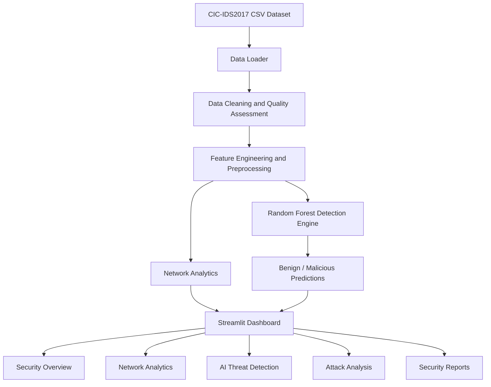

# CHRIST CyberPulse

### AI-Powered Network Traffic Analysis & Threat Detection

An interactive cybersecurity analytics platform that uses machine learning to classify recorded network flows as benign or malicious, analyse traffic patterns, investigate attacks, and generate security reports.

<p align="center">
  <a href="https://ciapython-mfuzqinq2nnzuuy2cpj37j.streamlit.app/">
    <strong>Live Application →</strong>
  </a>
</p>

---

## Overview

CHRIST CyberPulse is a Python-based network security analytics application developed as part of the Python CIA-3 coursework for the Master of Computer Applications programme at CHRIST (Deemed to be University), Bengaluru.

The platform combines network traffic analysis, data quality assessment, interactive visualisation, and a trained Random Forest classification model.

It processes recorded network flow datasets and provides an interactive environment for understanding traffic behaviour and identifying potentially malicious activity.

**Analysis mode:** Offline analysis of recorded network flows.

## Features

- **Security Overview:** Centralised view of network traffic, benign and malicious classifications, and security indicators.
- **Network Analytics:** Interactive visualisation and exploration of network flow characteristics.
- **AI Threat Detection:** Machine-learning-based classification of network flows with malicious probability scores.
- **Attack Analysis:** Exploration of traffic labels and attack-related patterns.
- **Security Reports:** Generation of downloadable analytical reports.
- **Data Quality Analysis:** Detection and reporting of missing values, infinite values, duplicate records, empty rows, and constant columns.
- **Dataset Support:** Loading and cleaning of CIC-IDS2017 CSV data.

## Technology Stack

| Area | Technology |
|---|---|
| Language | Python |
| Application framework | Streamlit |
| Data processing | Pandas, NumPy |
| Machine learning | Scikit-learn |
| Visualisation | Plotly |
| Model persistence | Joblib |
| Report generation | ReportLab |
| Testing | Pytest |
| Deployment | Streamlit Community Cloud |

## System Architecture



## Machine Learning Model

CHRIST CyberPulse uses a Random Forest classifier to distinguish benign network flows from malicious network flows.

### Model configuration

| Parameter | Value |
|---|---|
| Algorithm | RandomForestClassifier |
| Number of estimators | 150 |
| Maximum depth | 24 |
| Minimum samples per leaf | 2 |
| Class weighting | Balanced |
| Random state | 42 |
| Input features | 60 |
| Decision threshold | 0.5 |
| Imputation | Median |

The model pipeline uses median imputation followed by Random Forest classification.

### Dataset

The current evaluation uses the Friday-WorkingHours-Afternoon-DDos capture from CIC-IDS2017.

| Dataset characteristic | Value |
|---|---:|
| Original records | 225,745 |
| Records after deduplication | 223,112 |
| Benign records after deduplication | 97,718 |
| Malicious records after deduplication | 125,394 |
| Training records | 178,489 |
| Testing records | 44,623 |
| Model input features | 60 |

### Evaluation results

The primary reported evaluation uses a deduplicated, stratified 80/20 train-test split.

| Metric | Result |
|---|---:|
| Accuracy | 99.9843% |
| Precision | 99.9961% |
| Recall | 99.9766% |
| F1 Score | 99.9863% |
| ROC-AUC | 99.9979% |
| False positives | 1 |
| False negatives | 6 |

**Confusion matrix**

| Actual / Predicted | Benign | Malicious |
|---|---:|---:|
| Benign | 19,018 | 1 |
| Malicious | 6 | 25,598 |

These results describe performance on the specified held-out dataset split. They should not be interpreted as a guarantee of performance on unseen network environments or real-world live traffic. Independent evaluation on additional datasets is an important next step.

## Project Structure

```text
CHRIST-CyberPulse/
│
├── app.py
├── requirements.txt
├── pytest.ini
│
├── .streamlit/
│   └── config.toml
│
├── assets/
│   ├── cyberpulse-icon.png
│   └── cyberpulse-logo.png
│
├── core/
│   ├── analytics.py
│   ├── config.py
│   ├── data_loader.py
│   ├── detection_engine.py
│   └── preprocessing.py
│
├── data/
│   └── sample_data/
│
├── models/
│   ├── evaluation.py
│   ├── model_utils.py
│   ├── train_model.py
│   └── artifacts/
│       ├── cyberpulse_random_forest.joblib
│       ├── evaluation_metrics.json
│       ├── feature_schema.json
│       └── test_row_ids.npy
│
├── tests/
│   ├── conftest.py
│   ├── synthetic_cic.py
│   └── test_*.py
│
├── utils/
│   ├── charts.py
│   ├── helpers.py
│   ├── report_generator.py
│   └── styling.py
│
└── views/
    ├── 01_Security_Overview.py
    ├── 02_Network_Analytics.py
    ├── 03_AI_Threat_Detection.py
    ├── 04_Attack_Analysis.py
    └── 05_Reports.py
```

## Installation and Setup

### 1. Clone the repository

```bash
git clone https://github.com/raghavanand-prog/CIA_PYTHON.git
cd CIA_PYTHON
```

### 2. Create a virtual environment

```bash
python -m venv .venv
```

Activate it:

**macOS / Linux**

```bash
source .venv/bin/activate
```

**Windows**

```bash
.venv\Scripts\activate
```

### 3. Install dependencies

```bash
pip install -r requirements.txt
```

### 4. Add the dataset

Place a compatible labelled CIC-IDS2017 CSV file in:

```text
data/sample_data/
```

### 5. Run the application

```bash
streamlit run app.py
```

The application will be available at:

```text
http://localhost:8501
```

## Testing

Run the automated test suite using:

```bash
pytest
```

## Deployment

The application is deployed using Streamlit Community Cloud.

**Live application:**

https://ciapython-mfuzqinq2nnzuuy2cpj37j.streamlit.app/

## Current Scope and Limitations

- Analyses recorded network flow data rather than capturing live packets.
- Current model evaluation is based on a specific CIC-IDS2017 DDoS capture.
- High benchmark performance does not establish generalisation to unrelated network environments.
- Further testing on independent datasets and additional attack categories is recommended.

## Future Enhancements

- Evaluation on additional CIC-IDS2017 attack categories and independent datasets.
- Live network traffic ingestion.
- Expanded attack classification beyond binary benign/malicious detection.
- Improved model explainability.
- Alerting and incident investigation workflows.
- Extended security reporting and monitoring capabilities.

## Author

**Raghav Anand**

Master of Computer Applications (MCA)  
CHRIST (Deemed to be University), Bengaluru

## Academic Project

Python CIA-3

---

<p align="center">
  <strong>CHRIST CyberPulse</strong><br>
  Network Intelligence. Machine Learning. Security Analytics.
</p>
